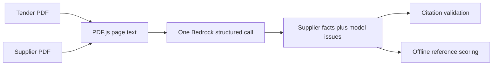
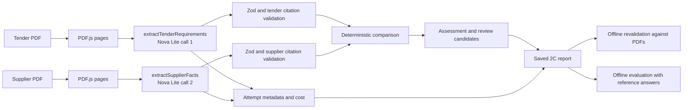
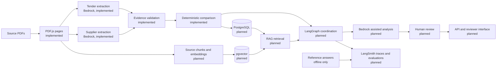
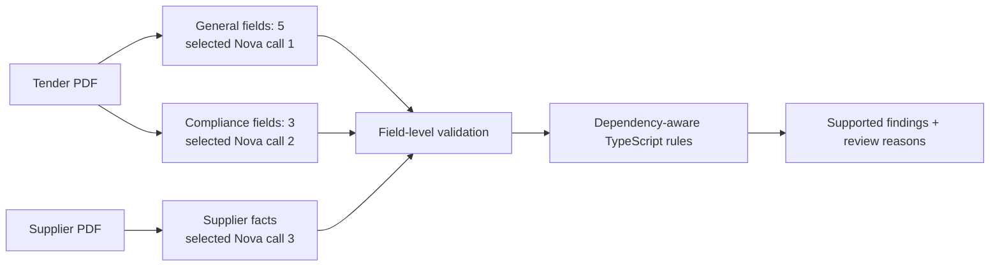

# TenderAI architecture

## Status and scope

**Implemented through Milestone 2D:** 2C remains unchanged, and a parallel 2D assessment flow splits tender requirements into two smaller structured calls, keeps supplier extraction separate, validates individual fields, and evaluates only findings supported by verified dependencies. The historical 2B and 2C outputs remain unchanged; new 2D experiments use model-specific, unique output filenames.

**Planned:** PostgreSQL, pgvector, RAG, LangGraph, LangSmith, an API, reviewer interface and AWS deployment. None is used by the current inference path.

## Milestone 2B baseline

The 2B call supplied both the tender and supplier PDF to one model invocation. Its response mixed supplier facts and `identifiedIssues`, so a tender deadline could become a supplier completion date. The three saved experiments are archived unchanged under `datasets/electrical-installation/baselines/2b/`; the local `tmp/extractions/` files also remain untouched.

| Archived run      | 2B factual checks with current scorer | Evidence valid | Observed failure                                                                                     |
| ----------------- | ------------------------------------: | -------------- | ---------------------------------------------------------------------------------------------------- |
| Voltline baseline |                                 11/12 | No             | Missing insurance issue, wrong-page certificate quote, cover amount as policy ID                     |
| Sparrow           |                                  9/12 | No             | Tender date cited as supplier date; insurance IDs lack supporting quotes                             |
| Arcwell           |                                 10/12 | No             | Tender date cited as supplier date; insurance IDs lack supporting quotes; literal `"null"` condition |

Voltline's first live score was **10/12** before the 2B scorer began accepting a qualification with a trailing award year; the archived response itself has not changed. The archive also includes the second Voltline run. These scores are historical measurements, not a target for the new contracts.

## Milestone 2C implemented flow

| Component                             | Responsibility and contract                                                                                                                                                                                                                                                                                                                    |
| ------------------------------------- | ---------------------------------------------------------------------------------------------------------------------------------------------------------------------------------------------------------------------------------------------------------------------------------------------------------------------------------------------- |
| `packages/pdf`                        | `ExtractedPdf`: document ID and one-based `{ page, text }` entries. No model or reference data.                                                                                                                                                                                                                                                |
| `packages/extraction/src/schema.ts`   | `TenderRequirements` holds cited tender dates, currency, reference count and mandatory certificate flags. `SupplierFacts` holds cited supplier identity, commercial terms, dates, qualifications, references and insurance. Neither 2C schema has compliance findings. Nullable fields represent absence. The 2B schema remains for old files. |
| `packages/extraction/src/facts.ts`    | Each operation receives only its own `ExtractedPdf`, sends its page-labelled text to Nova Lite through `ChatBedrockConverse.withStructuredOutput()`, and returns `ExtractionReport<T>` with parsed facts, validation, raw response, token usage, latency, model, region and estimated per-call cost.                                           |
| `packages/extraction/src/evidence.ts` | Validates document ID, page and exact quoted text with whitespace normalization. It checks straightforward values such as dates, numeric terms and labelled policy IDs. Unsupported values and literal `"null"` are errors, not corrected facts.                                                                                               |
| `packages/comparison`                 | Compares only validated facts and requirements. It emits cited late completion, explicit missing mandatory insurance and conflicting completion dates. Missing inputs or invalid evidence stop unsupported conclusions and require review. `ReviewCandidate` names subjective topics for later human or AI analysis.                           |
| `packages/evaluation`                 | Offline only. It scores supplier facts, deterministic findings and citation validity separately against `reference.json`, and still reads 2B baseline files. It is never imported by extraction or comparison.                                                                                                                                 |

`runAssessment()` invokes tender and supplier extraction separately, then combines their reports. Each subreport retains its invocation attempts; `totalEstimatedCostUsd` sums both estimates only when each attempt has a supported estimate. An unavailable estimate remains unavailable rather than being treated as zero. No automatic retries occur.

### Evidence and source boundaries

Every non-null model fact has `{ value, evidence: [{ documentId, page, quote }] }`. A tender fact must cite the tender document; a supplier fact must cite its supplier document. Comparison findings carry the validated citations from both sides. A quote must occur on its cited page; presence alone does not prove a value, so direct date, numeric and policy-ID checks run where the source format permits. Qualitative meaning and certificate authenticity still require review.

The model sees page text, never `reference.json`. The reference file is used only by fixture generation, tests and offline evaluation. Revalidation rereads the PDFs and checks a saved 2C output without another Bedrock call. Parse or citation failure preserves any available raw response, usage, metadata and cost; comparison returns review reasons and does not create unsupported findings.

The practical completion deadline is **not** the tender closing date. The comparison uses the cited required practical completion date and the supplier's cited programme completion date. A separate commercial completion date is retained for conflict detection. An award year is not treated as proof of licence expiry. Warranty exclusions and qualification validity are review candidates, never automatic findings in 2C.

## Target architecture (planned)

PostgreSQL will persist versioned documents, extracted facts, citations, assessments and invocation attempts. pgvector will index source chunks for RAG; neither is needed for the current small synthetic PDFs. RAG will ground later criterion-level analysis in retrieved passages after source ingestion. LangGraph will coordinate extraction, comparison and human review states when the workflow warrants it. LangSmith will measure quality with the offline reference set and observe future workflows; reference answers must never enter model prompts, retrieval indexes or inference-time business rules. The API, frontend and AWS infrastructure come after reliability work.

## Decisions

- **Separate model calls:** supplier extraction cannot see tender text, which removes the observed tender-as-supplier citation path.
- **Typed, nullable contracts:** JSON null means missing; the string `"null"` is rejected in new supplier outputs.
- **Deterministic comparison first:** three rules have direct evidence and clear inputs. Subjective warranty and qualification judgments wait for review.
- **Strict provenance:** invalid sources remain visible as errors. The system never rewrites a model citation to make it pass.
- **Historical compatibility:** 2B reports stay archived and scorable, while new files use version `2c` and a separate filename.
- **Cost transparency:** per-call usage and estimates are kept; totals never imply an exact AWS bill.

## Milestone 2D — targeted extraction and field-level validation

Both tender groups are distinct structured calls to the selected direct Nova Lite or Nova Pro model in `ap-southeast-2`. Supplier facts use the same selected model in a third call. All three preserve raw responses, diagnostics, model ID, region, usage, latency and model-specific estimated costs. No retrieval database or vector search is used in this milestone.

**Rationale.** Two live 2C Voltline assessments returned fragmented or incomplete eight-field tender tool calls. A supplier response correctly reported an absent certificate but incorrectly classified the coverage amount as a policy identifier. Prompt tuning alone did not reliably fix these issues. 2D divides tender extraction by field type (never by hardcoded page number) and checks a finding's exact validated dependencies.

**Source boundaries.** Both tender groups receive only the tender PDF; supplier extraction receives only the supplier PDF. No inference code sees reference.json. The two tender group results remain available separately, including parse errors; invalid or partial calls are never silently combined or corrected.

**Contracts.** The assembled tender retains the TenderRequirements shape; unavailable group fields become JSON null and the corresponding field status is invalid (or missing if the group succeeded and legitimately returned null). SupplierFacts remains the supplier contract. Field-level validation records valid, invalid or missing for individual fields, including insurance status independently from policy ID. Unsupported citations are not rewritten.

**Rule dependencies.** Late completion requires verified tender deadline and supplier programme dates. Conflicting dates require verified supplier programme and commercial dates. Missing mandatory insurance requires a verified tender requirement and a separately verified supplier status explicitly_missing. An invalid policy ID does not invalidate an independently supported missing-certificate status. Any required invalid/missing source becomes a review reason instead of an unsupported compliance finding.

**Scope limits.** Supplier field-level recovery works only if the supplier's complete JSON object passes Zod structural validation; malformed supplier objects remain unavailable. Invalid tender groups stay invalid even when raw tool calls contain some partial values. Automatic retries and field repair are not implemented. Existing regex-based citations are tailored to synthetic source wording and do not authenticate real insurance certificates.

**Backward compatibility.** Existing 2C commands and outputs remain untouched. The saved `tmp/extractions/voltline-2d.json` result also remains untouched. New experiments use `tmp/extractions/<supplier>-2d-<model>-<timestamp>-<id>.json` with exclusive creation. Offline evaluation continues to use reference.json strictly after inference and surfaces validation states separately from fact accuracy and deterministic findings.

### Commands

    # Each command makes three billable Bedrock calls; run manually
    pnpm extract:2d voltline nova-lite
    pnpm extract:2d voltline nova-pro

    # Use each command's printed saved path for offline checks
    pnpm revalidate:2d <saved-path>

    # Offline scoring against reference answers
    pnpm evaluate:extraction <saved-path>

Compare the same supplier across both models: per-field validation and citations, findings, offline factual accuracy, per-call token usage and latency, and total estimated cost. The existing Nova Lite 2D result is preserved; Nova Pro behaviour has only been tested offline with mocks. The [AWS Sydney on-demand price list](https://pricing.us-east-1.amazonaws.com/offers/v1.0/aws/AmazonBedrock/current/ap-southeast-2/index.json) was checked on 17 October 2026. Direct default-tier estimates use Lite at USD $0.063/$0.252 and Pro at $0.84/$3.36 per million input/output tokens. These estimates are not billed totals; unsupported tiers and profiles have no estimate.
