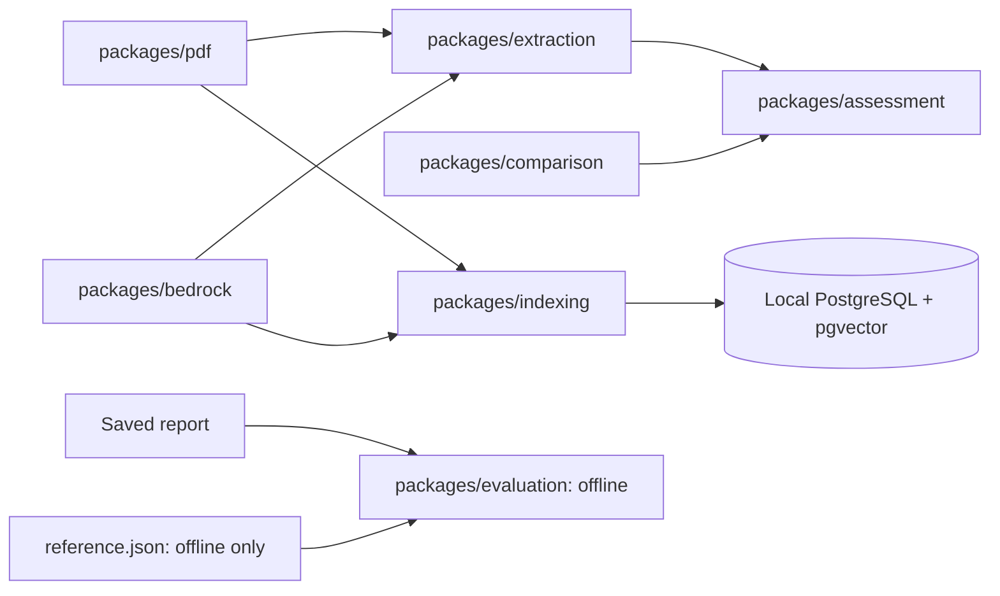
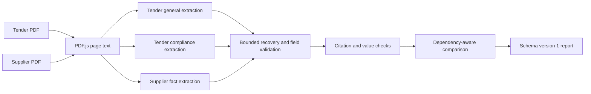
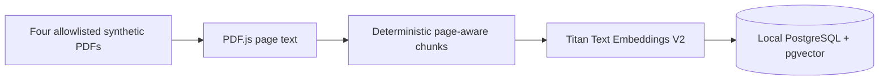

# TenderAI architecture

## Module dependencies

`packages/assessment/src/run.ts` exports `runTenderAssessment()`, the only end-to-end assessment entry point. Extraction returns validated facts; comparison consumes them without invoking Bedrock or PostgreSQL. The PDF package knows nothing about AI or storage. Indexing remains separate from assessment. Evaluation receives saved reports and reference data only through the offline CLI.

## Assessment flow

The orchestrator runs general requirements, compliance requirements and supplier facts in that order. Each operation receives only its own document. Nova Lite or Nova Pro is selected for all three calls in `ap-southeast-2`. A failed invocation or incomplete structured response permits one retry for that operation. A complete response with unsupported evidence does not automatically retry. Recovered candidates need valid structure and their own supporting citations; conflicting supported values remain unresolved. Insurance certificate status and policy ID are checked separately.

`compareValidatedCompliance()` produces only `late_completion`, `conflicting_dates` and `missing_evidence` when their specific tender and supplier inputs validate. Other invalid fields do not suppress supported findings. Unsupported dependencies require review. Warranty terms and qualification validity are review candidates, not automatic findings.

### Data contracts

- `ExtractedPdf` has a stable document ID and one-based `{ page, text }` entries.
- `TenderRequirements` and `SupplierFacts` use nullable missing facts and `{ value, evidence: [{ documentId, page, quote }] }` citations. General and compliance tender groups remain separate in the report.
- Each model attempt records model ID, region, service tier, latency, token usage, response metadata, raw response, error and estimated cost where available. Recovery records original attempt and tool-call provenance, unresolved fields and field errors. `knownEstimatedCostUsd` sums priced attempts; `totalEstimatedCostUsd` is null if any attempt cannot be priced.
- Current saved reports use **`schemaVersion: 1`**. The `assess`, `revalidate` and `evaluate` commands share that version. There is no parser for obsolete report formats. Existing local `tmp/extractions/` files are left untouched; older formats must be regenerated for the current offline tools.

### Evidence and reference isolation

Citations must point to the correct document and page, and quotations must occur in PDF.js extracted text with only reasonable whitespace normalization. Deterministic checks additionally verify straightforward values such as dates, price, duration, warranty months, insurance status and labelled policy IDs. A quote alone does not establish every qualitative claim or certificate authenticity. Unsupported facts remain invalid; the pipeline does not rewrite model output to make it pass.

Only fixture generation, tests and offline evaluation read `datasets/electrical-installation/reference.json`. Runtime assessment and indexing never import it, and reference answers must not enter prompts, vector indexes or inference-time rules.

### Model and cost boundaries

The [AWS public Bedrock Sydney price list](https://pricing.us-east-1.amazonaws.com/offers/v1.0/aws/AmazonBedrock/current/ap-southeast-2/index.json) was checked on 17 October 2026. Direct Standard/default rates per million tokens are USD $0.063 input / $0.252 output for `amazon.nova-lite-v1:0` and $0.84 input / $3.36 output for `amazon.nova-pro-v1:0`. Estimates use returned token counts and are not exact AWS bills. Other regions, cross-region profiles, unsupported tiers, cached-token rates or missing usage do not receive invented prices.

## Indexing flow

`packages/indexing` preserves stable IDs, one-based page numbers, zero-based chunk indexes, exact PDF.js text slices, UTF-16 offsets and SHA-256 hashes. Its provider interface isolates embedding calls from chunking and storage. The Titan provider uses `amazon.titan-embed-text-v2:0`, `ap-southeast-2` and 1,024 dimensions. Matching content hash, chunker version and embedding metadata skip model calls and writes. A changed document replaces its chunks in one transaction; failed embedding or storage leaves the prior document intact.

The index has no retrieval query or connection to assessment prompts. The local database may retain a `tender` row from an earlier smoke test with `mock:offline-smoke` vectors. Model metadata prevents it being mistaken for a Titan-indexed document during ingestion, but retrieval should explicitly exclude mock vectors until a separate reliability fix removes them. No database contents are changed by this cleanup. Concurrent indexing of the same changed document can duplicate billable embedding calls.

## Scope and next steps

The CLI uses synthetic PDFs only. PDF.js does not OCR scans, and the evidence checks are tuned to their wording. There is no semantic retrieval, retrieval-grounded extraction, LangGraph, LangSmith, API, reviewer interface or AWS deployment. Milestone 3B can add retrieval against the local index while keeping current assessment prompts and validation unchanged. A later step can integrate retrieved passages at the assessment boundary.
