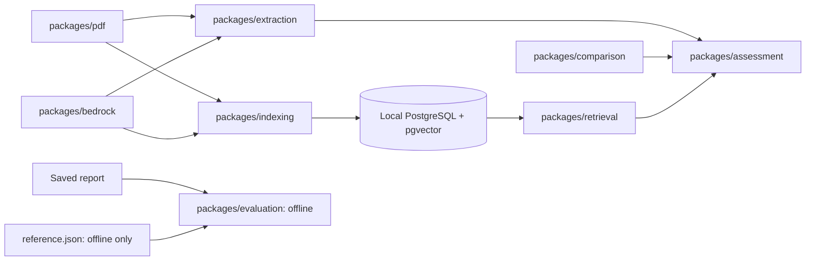
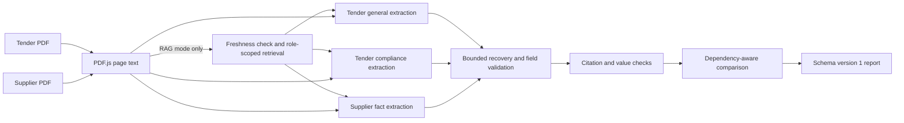
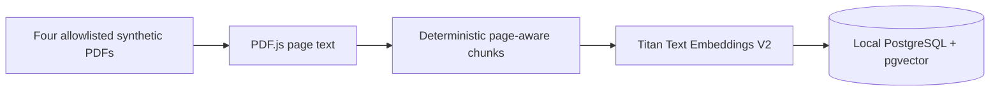
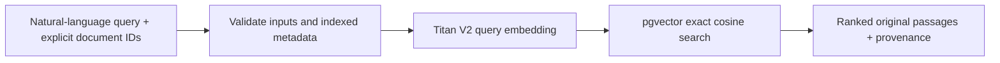

# TenderAI architecture

## Module dependencies

`packages/assessment/src/run.ts` exports `runTenderAssessment()`, the only end-to-end assessment entry point. Full-document mode remains the default. Experimental RAG mode prepares role-scoped passages with retrieval before invoking the same extraction functions. Extraction returns validated facts; comparison consumes them without invoking Bedrock or PostgreSQL. The PDF package knows nothing about AI or storage. Indexing remains separate from assessment. Evaluation receives saved reports and reference data only through the offline CLI.

## Assessment flow

The orchestrator runs general requirements, compliance requirements and supplier facts in that order. Each operation receives only its own document. Full mode uses complete PDF text. RAG mode checks both indexed documents before any model call, then runs two general, two compliance and three supplier queries with topK 2 per query. Tender queries search only tender chunks; supplier queries search only the selected supplier. Returned chunks are checked against exact PDF slices, deduplicated within each operation and labelled with document ID, page and chunk index. Nova Lite or Nova Pro is selected for all three extraction calls in `ap-southeast-2`. A failed invocation or structurally incomplete response permits one additional attempt. When the first response is available, the retry includes its structural validation errors and requests a complete object; a complete response with unsupported evidence does not automatically retry. Recovered candidates need valid structure and their own supporting citations; conflicting supported values remain unresolved. Insurance certificate status and policy ID are checked separately.

`compareValidatedCompliance()` produces only `late_completion`, `conflicting_dates` and `missing_evidence` when their specific tender and supplier inputs validate. Other invalid fields do not suppress supported findings. Unsupported dependencies require review. Warranty terms and qualification validity are review candidates, not automatic findings.

### Data contracts

- `ExtractedPdf` has a stable document ID and one-based `{ page, text }` entries.
- `TenderRequirements` and `SupplierFacts` use nullable missing facts and `{ value, evidence: [{ documentId, page, quote }] }` citations. General and compliance tender groups remain separate in the report.
- Each model attempt records model ID, region, service tier, latency, token usage, response metadata, raw response, error and estimated cost where available. Recovery records original attempt and tool-call provenance, unresolved fields and field errors. `knownEstimatedCostUsd` sums priced attempts; `totalEstimatedCostUsd` is null if any attempt cannot be priced.
- Current saved reports use **`schemaVersion: 1`**. The `assess`, `revalidate` and `evaluate` commands share that version. There is no parser for obsolete report formats. Existing local `tmp/extractions/` files are left untouched; older formats must be regenerated for the current offline tools.
- New reports identify `mode`; RAG reports also include query and chunk provenance, distinct chunk counts and Titan request count. The CLI records end-to-end latency. Older version 1 reports without `mode` remain accepted by the offline tools.

### Evidence and reference isolation

Citations must point to the correct document and page, and quotations must occur in the original full PDF.js extracted text with only reasonable whitespace normalization. In RAG mode, each citation must also occur in a retrieved passage supplied to its own general, compliance or supplier extraction operation. Recovery applies the same check before selecting candidate values; offline revalidation reconstructs the passages from recorded chunk references and original PDFs. The complete PDF remains the source of truth. Deterministic checks additionally verify straightforward values such as dates, price, duration, warranty months, insurance status and labelled policy IDs. A quote alone does not establish every qualitative claim or certificate authenticity. Unsupported facts remain invalid; the pipeline does not rewrite model output to make it pass.

Only fixture generation, tests and offline evaluation read `datasets/electrical-installation/reference.json`. Runtime assessment, indexing and retrieval never import it, and reference answers must not enter prompts, vector indexes, query embeddings or inference-time rules.

### Offline extraction evaluation

`expectedExtraction` in the synthetic reference dataset gives explicit values, including nulls, for all eight tender and fifteen supplier scoring leaves. The evaluator walks the extraction Zod schemas, checks reference completeness and types, and compares the final saved values. The older cited `answers` and `issues` remain for fixture tests and finding expectations. Saved `schemaVersion: 1` reports work in full and RAG modes; evaluation never invokes Bedrock or PostgreSQL.

Dates compare as ISO values, numbers and booleans exactly. Strings are trimmed, whitespace-collapsed and compared without case; punctuation remains significant. A trailing parenthesised year may be omitted for `supervisorQualification`, but two explicit years must agree. Nullable insurance objects retain separate status and policy ID checks even when the expected object is null. Comparable project names, including their years, compare as an order-independent multiset, so duplicate or wrong names fail even when the count matches. The Sparrow warranty condition reference uses the stated page-one phrase; its separate, unfinished warranty schedule remains an unscored qualitative issue. Paraphrases of conditions may fail this conservative string comparison.

Tender, supplier and combined accuracy show passed and total fields plus failed comparisons. Each field retains its actual value, reference value and saved evidence status. Recovery field errors and unavailable extraction groups prevent placeholder nulls from counting as correct absences; where older reports lack recovery provenance, the result states that limitation. `overallResult` describes evaluation quality, while `procurementReviewStatus` preserves the independent assessment status. A correct missing-evidence finding can therefore coexist with `requires_review` procurement status and an acceptable evaluation result. Offline evaluation reads saved evidence flags; run `revalidate` first when those flags need recomputation against the PDFs and recorded RAG passages.

### Model and cost boundaries

The [AWS public Bedrock Sydney price list](https://pricing.us-east-1.amazonaws.com/offers/v1.0/aws/AmazonBedrock/current/ap-southeast-2/index.json) was checked on 17 October 2026. Direct Standard/default rates per million tokens are USD $0.063 input / $0.252 output for `amazon.nova-lite-v1:0` and $0.84 input / $3.36 output for `amazon.nova-pro-v1:0`. Estimates use returned token counts and are not exact AWS bills. RAG's Titan query embedding calls are counted but not priced in the report; the existing estimated totals cover Nova calls only. Other regions, cross-region profiles, unsupported tiers, cached-token rates or missing usage do not receive invented prices.

## Indexing flow

`packages/indexing` preserves stable IDs, one-based page numbers, zero-based chunk indexes, exact PDF.js text slices, UTF-16 offsets and SHA-256 hashes. Its provider interface isolates embedding calls from chunking and storage. The Titan provider uses `amazon.titan-embed-text-v2:0`, `ap-southeast-2` and 1,024 dimensions. Matching content hash, chunker version and embedding metadata skip model calls and writes. A changed document replaces its chunks in one transaction; failed embedding or storage leaves the prior document intact.

The four synthetic PDFs are allowlisted for manual indexing. Concurrent indexing of the same changed document can duplicate billable embedding calls.

## Retrieval flow

`packages/retrieval` checks each requested document before embedding the query. It requires `amazon.titan-embed-text-v2:0`, `ap-southeast-2` and 1,024 dimensions, and rejects missing documents or documents without compatible chunks. A parameterized SQL query applies the document allowlist and embedding metadata filters to both `source_documents` and `document_chunks`; `embedding <=> query_vector` sorts by ascending cosine distance with a bounded limit. No approximate vector index is used. Results retain source name, one-based page, zero-based chunk index, exact stored text, UTF-16 offsets and content hash. Assessment RAG mode also checks current PDF content hashes and chunker version before retrieval; it never reindexes or writes to the database.

## Scope and next steps

The CLI uses synthetic PDFs only. PDF.js does not OCR scans, and the evidence checks are tuned to their wording. Similarity-ranked passages are candidates for evidence, not proof of a claim. With only two or three chunks per document, RAG may send most of the source text while adding seven Titan calls. TopK 2 can still miss a relevant passage, and no quality or cost advantage is assumed without paired offline evaluation. There is no LangGraph, LangSmith, API, reviewer interface or AWS deployment.
